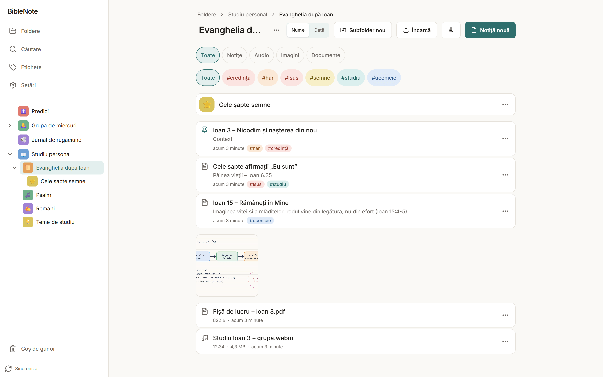
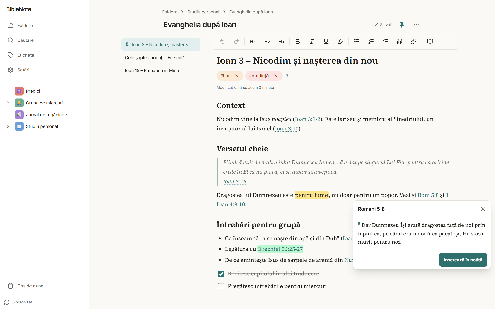
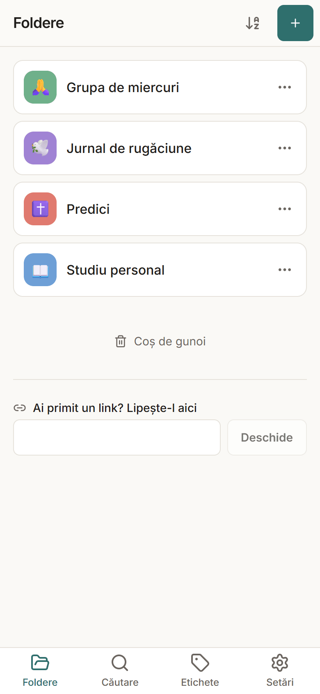
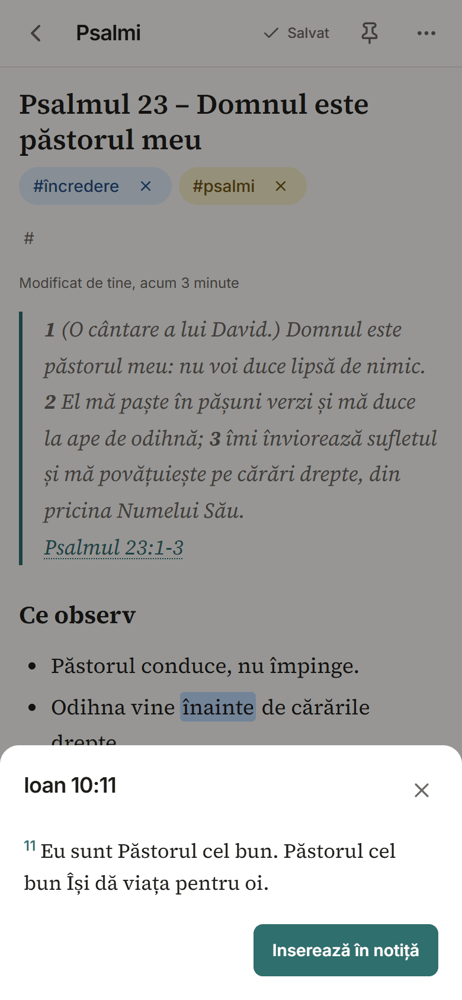
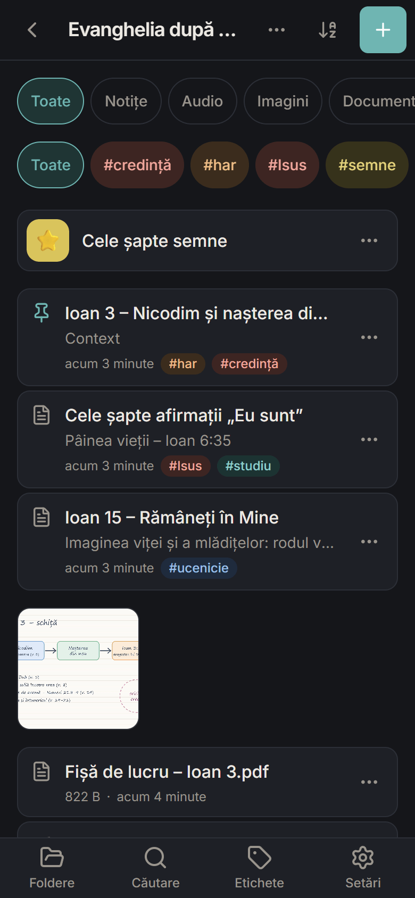
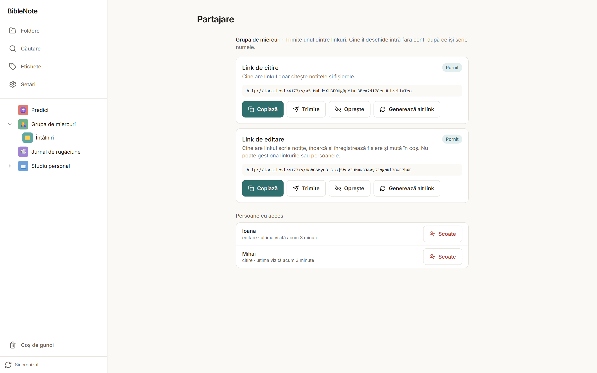
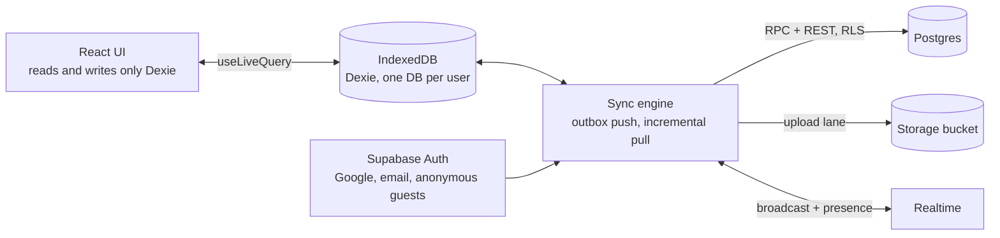

# BibleNote

[](https://github.com/Andeaf/BibleNote/actions/workflows/ci.yml)


An offline-first Bible study notebook, installable as a PWA on phones and desktops, that syncs
between devices, records audio, stores files and shares folders by link. Built for a handful of
people and their guests, on free tiers only, with **no application server**: a React app talks to
IndexedDB, and a separate sync engine talks to Supabase (Postgres with row-level security, Storage,
Realtime, Auth). The only server-side code outside Postgres is a small daily keep-alive function.

The user interface is in Romanian; code, comments, tests and this document are in English.

**Status:** feature-complete for the planned v1 scope and deployed. Field testing on phones (iOS and
Android) is in progress before the app is handed over to its user, so a few behaviours listed under
[In progress](#in-progress) are still being verified on real devices.

Live: https://biblenote-app.vercel.app. Anyone who signs in with an account can create their own
folders; anyone can enter a shared folder as a guest through a share link, without an account.

## Screenshots

Taken on a demo account with sample content.





<p>
  
  
  
</p>



## Features

- **Local-first notes**: a rich-text editor (Tiptap) with headings, lists, checklists, quotes,
  links and highlights; autosave; tags with autocomplete; instant search with diacritics-insensitive
  matching; pin, move, drag & drop on desktop.
- **Sync between devices** through an outbox: edits made offline are queued and sent when the
  connection returns; other devices receive changes within seconds over Realtime.
- **Conflict handling without data loss**: notes carry a server-incremented version; a save against
  a stale version becomes a separate "(conflict – name, date)" note instead of overwriting.
- **Files**: upload photos, PDFs, documents and audio (50 MB limit, images compressed client-side),
  with an image gallery, an audio player, an in-app PDF viewer and an LRU offline cache.
- **Audio recorder** that never loses sound silently: chunks are written to IndexedDB every 5 s,
  long recordings are split gap-free at 45 MB, and an interrupted recording is recovered on the
  next start.
- **Sharing by link**: per-folder read and edit links that can be disabled or regenerated, guests
  without accounts, a list of people with access, and "X is editing" presence.
- **Bible references**: "Ioan 3:16", "1 Cor 13:4-7", "Psalmul 23" and the usual Romanian forms are
  detected while typing and shown as discreet links; a click shows the passage, which can be inserted
  as a quote. The text (Cornilescu, public domain) is precached, so it works offline.
- **Trash with safe cleanup**: soft delete everywhere, 30-day retention decided by the server, and an
  orphan sweep that only runs after a successful pull and only on the owner's device.
- **Offline session**: the app opens from the stored session even when the access token has expired
  and there is no network; unsynced work survives a rejected refresh token.
- **Appearance synced across devices**, ZIP export (streamed to disk on desktop), print stylesheet,
  install prompts, a keep-alive job for the free Supabase tier.

### In progress

- Field tests on real phones: recording behaviour when the screen locks or a call comes in (iOS),
  real audio bitrate on Safari, Google sign-in inside the installed iOS app.
- The end-to-end acceptance checklist on Chrome Android, Safari iOS and desktop browsers.

### Not planned for v1

- Real-time collaborative editing of the same note (presence only).
- Self-service email sign-up and password reset (email + password accounts are created by the
  maintainer; Google sign-in is the primary path).
- Any paid infrastructure.

## Architecture



1. The UI reads and writes **only IndexedDB** (Dexie, `useLiveQuery`). There is no other store and
   no state-management library.
2. Every data-layer write puts the row and an **outbox entry** in one transaction. The sync engine
   (`src/sync/`) pushes the outbox and pulls incrementally; it is the only code that talks to
   Supabase tables, it never imports browser APIs, and it is tested against a fake API with
   `fake-indexeddb`.
3. **No application server.** Sensitive operations are `security definer` Postgres functions;
   access control is one SQL helper, `has_space_access(space_id, min_role)`, reused by the table
   policies, the Storage policies and the Realtime channel policies. Column-level grants replace
   upserts.
4. Notes use **compare-and-set** (`save_note` with a base version); everything else is
   last-write-wins. Deletes are soft (`deleted_at`), and a hard delete only scrubs the row so that
   it can still propagate.
5. Files go through a **transfer lane** separate from the metadata queue: object first, then the
   row; idempotent paths; retries at 1/5/15/60 min on a flaky connection; the local blob stays
   until both stages are confirmed.
6. The frontend ships only the project URL and the **publishable** key. The secret key exists only
   locally, for the security test.

### Design decisions worth discussing

- **Why an outbox instead of a CRDT or a sync library**: the data is a tree of folders with
  mostly single-writer notes; an ordered outbox with coalescing, dependency ordering (a note waits
  for its folder's insert) and inflight recovery is simpler to reason about and to test than a
  CRDT, and conflicts are rare enough that a visible conflict copy beats a silent merge.
- **Why a pure sync engine**: `src/sync/engine.ts` has no browser imports; `runtime.ts` wires
  timers, online and visibility events. The engine's invariants (ordering, retries, access loss,
  conflict copies, upload lanes) are covered by tests against `FakeApi`, which enforces the same
  server rules the ordering depends on.
- **Why RLS and RPCs instead of an API server**: zero infrastructure to run, and the whole
  authorisation surface is reviewable in SQL. The trade-off is that mistakes are subtle, so there
  is a regression test that runs against a real project with six throwaway users (owner, editor,
  viewer, stranger, newcomer, anonymous guest) and exercises every cell of the access matrix,
  Storage and Realtime.
- **Deleting for good is the owner's job**: the 30-day purge and the orphan sweep compare with
  the server's rows, run only after a successful pull, and never touch this device's unsent
  uploads. Nothing is ever removed on the strength of a stale local copy.
- **Recording on phones**: MediaRecorder output is persisted in 5-second chunks, parts are split
  before the previous one stops (no gap), a wake lock and a `beforeunload` guard are held, and
  `mute` plus a watchdog report interruptions instead of producing a silent file.
- **Service worker with `registerType: 'prompt'`**: the app never reloads itself; an update is
  offered, and never while a recording is active.

## Tech stack

| Area | Choice |
| --- | --- |
| UI | React 19, TypeScript 6, Vite 8, Tailwind CSS 4, React Router 8, Radix UI primitives, dnd-kit, lucide-react |
| Editor | Tiptap 3 (MIT extensions only) with custom decorations for Bible references |
| Local data | Dexie 4 (IndexedDB), `dexie-react-hooks` |
| Backend | Supabase: Auth, Postgres 17 with RLS, Storage, Realtime; `@supabase/supabase-js` 2 |
| PWA | `vite-plugin-pwa` 2 with Workbox 7, self-hosted fonts, precached Bible text |
| Files | `react-pdf` 11 (pdf.js worker precached), `client-zip` for streamed exports |
| Tooling | Vitest 5, `fake-indexeddb`, ESLint 10, Prettier 3, GitHub Actions, Vercel |
| Runtime | Node ≥ 22.12 for the toolchain; scripts run as TypeScript with Node's type stripping |

## Project structure

```
.github/workflows/   ci.yml (typecheck, lint, test, build) · keepalive.yml (backup keep-alive, every 3 days)
api/                 keepalive.ts (Vercel Function behind the daily Vercel Cron keep-alive)
data/                Bible source (USFX XML)
public/              icons, fonts, generated Bible JSON (precached), privacy.html (privacy policy)
scripts/             build-bible.ts · build-fonts.ts · build-icons.ts
supabase/migrations/ schema, RLS, RPCs, Storage and Realtime policies
supabase/tests/      rls.test.ts, the security regression test (runs on demand)
src/
  auth/              AuthProvider, guards, offline session logic
  components/        shared UI (AppShell, PageHeader, NoticeStack, dialogs, menus)
  data/              Dexie + outbox writes per area (spaces, folders, notes, files, …)
  features/          folders, notes (editor), files, recorder, share, bible, search, tags, trash,
                     settings, export, install
  i18n/ro.ts         every UI string
  lib/               Supabase client, Dexie schema, storage provider, blob cache, helpers
  sync/              engine, outbox, transfers, realtime hub, runtime, housekeeping, fake API
```

## Running locally

Prerequisites: Node 22.12 or newer, npm, a free Supabase project. A Google Cloud OAuth client is
optional (email + password sign-in works without it).

```bash
git clone https://github.com/Andeaf/BibleNote.git
cd BibleNote
npm install
```

### 1. Supabase project

1. Create a project (any region). From **Project Settings → General** note the project reference
   (`<ref>`); from **Project Settings → API Keys / Data API** note the URL `https://<ref>.supabase.co`
   and the **publishable** key. The secret key is only ever used locally for the security test.
2. Apply the migrations:

   ```bash
   npx supabase login
   npx supabase link --project-ref <ref>
   npx supabase db push
   ```

3. **Authentication → URL Configuration**: add `http://localhost:5173/**` (and your production URL)
   to the redirect URLs.
4. **Authentication → Sign In / Providers**: keep Email enabled, enable **Anonymous sign-ins**
   (guests through share links), and optionally Google. For Google, the OAuth client needs the
   JavaScript origin `https://<ref>.supabase.co` and the redirect URI
   `https://<ref>.supabase.co/auth/v1/callback`.
5. Every signed-in account may create its own folders; guests who join through a share link
   (anonymous sign-in) only see what their link gives them. Email + password accounts are created
   from **Authentication → Users** (there is no sign-up form, since the free email service only
   reaches the project's team); with Google, publish the OAuth consent screen so that any Google
   account can sign in, not only its test users. Publishing needs a home page, a privacy policy
   link (`/privacy.html`) and, as authorised domains, your app's domain and `<ref>.supabase.co`.
6. **Project Settings → Realtime**: disable public access. The app only uses private channels,
   authorised in Postgres.

### 2. Environment and run

```bash
cp .env.example .env.local   # then fill in VITE_SUPABASE_URL and VITE_SUPABASE_PUBLISHABLE_KEY
npm run dev                  # http://localhost:5173
```

To try the service worker and the install flow, use the production build:

```bash
npm run build
npm run preview
```

| Command | What it does |
| --- | --- |
| `npm run dev` | dev server |
| `npm run build` | typecheck + production build to `dist/` |
| `npm run preview` | serve `dist/` (service worker works here) |
| `npm run typecheck` / `npm run lint` / `npm run format` | `tsc -b`, ESLint + Prettier check, Prettier write |
| `npm test` | Vitest, single run |
| `npm run test:rls` | security regression test against a real project (see below) |
| `npm run build:bible` / `build:fonts` / `build:icons` | regenerate the Bible JSON, the font subsets, the PWA icons |

## Testing

- `npm test` runs the unit tests and the sync engine tests (299 tests in 29 files): ordering,
  retries, conflicts, uploads, access loss, housekeeping, the recorder with an injectable clock,
  the reference parser, export, search, i18n (every string must use comma-below diacritics).
- `npm run test:rls` runs `supabase/tests/rls.test.ts` against a real project. It needs
  `.env.test.local` (ignored by git) with `SUPABASE_URL`, `SUPABASE_ANON_KEY` and
  `SUPABASE_SERVICE_ROLE_KEY`, creates throwaway users (`rls-*@biblenote.test`), checks the whole
  access matrix, Storage and Realtime (35 tests), then deletes everything it created. It is never
  run in CI.
- CI (`.github/workflows/ci.yml`) runs typecheck, lint, tests and the build on every push.

## Deployment

- **Vercel** (Hobby): framework Vite, build `npm run build`, output `dist/`; `vercel.json` has the
  SPA rewrite (everything except `/api/`), a daily cron and `no-cache` headers for the service
  worker and the manifest. Environment variables: `VITE_SUPABASE_URL`,
  `VITE_SUPABASE_PUBLISHABLE_KEY`.
- **Keep-alive**: free Supabase projects pause after a week without activity. A Vercel Cron job
  calls `api/keepalive.ts` once a day; it POSTs the public `ping()` RPC with the two variables
  above (the publishable key goes only in the `apikey` header) and answers only `ok` or `error`.
  `keepalive.yml` does the same every three days as a backup (GitHub disables scheduled workflows
  of a public repository after 60 days without activity); it needs the repository secrets
  `SUPABASE_URL` and `SUPABASE_ANON_KEY`.

## Known limitations

- Designed for a handful of people and their guests, not for many concurrent editors; there is
  no collaborative editing of a single note.
- Free-tier budgets: 1 GB of files, 500 MB of database, 5 GB of egress per month, shared by every
  account (there is no per-account quota); the app shows the storage used and compresses images,
  and recordings use a voice bitrate (~22 MB per hour).
- Phones export only the notes (a full export with recordings can be hundreds of MB and is done
  from a desktop browser, streamed to disk in Chrome and Edge).
- On iOS, Google sign-in inside the installed app may bounce back to Safari; email + password is
  the fallback. Safari may ignore the requested audio bitrate.
- The trash is emptied only when the owner opens the app; nothing is lost in the meantime.
- Romanian UI only; the Bible text is a single translation.

## Security

See [SECURITY.md](SECURITY.md) for the reporting process and a summary of the security model.

## Attributions

- Bible text: _Romanian Corrected Cornilescu Version_, public domain, from
  [open-bibles](https://github.com/seven1m/open-bibles) (`ron-rccv.usfx.xml`), with cedilla
  diacritics normalised to comma-below.
- Fonts: [Inter](https://rsms.me/inter/) and
  [Source Serif 4](https://github.com/adobe-fonts/source-serif), SIL Open Font License, self-hosted.

## License

Source-available. The code is published for reference and portfolio purposes; see
[LICENSE](LICENSE).
